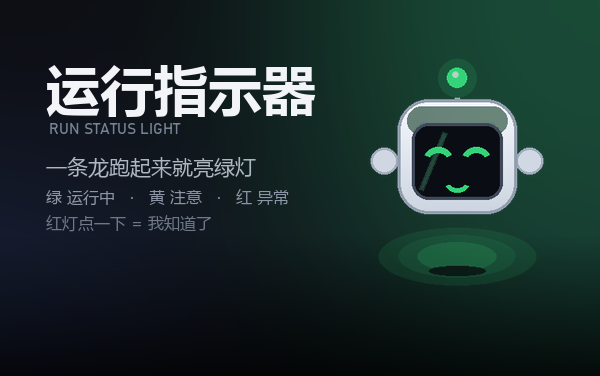

# zzzod-plugin-bangboo-companion · 运行指示器

桌面小信号灯：把一条龙的运行状态变成远处一眼能看清的信号（默认是一个悬浮小机器人，也能切成三色灯柱），出异常会主动闪灯提醒。

读的是真实运行信号（运行状态 / 运行记录 / 监控状态），不操作游戏、不占一条龙链位。

> 老名字叫「邦布安灯」。设计思路借鉴工厂的安灯（Andon）系统：状态可视、异常呼叫、应答复位；名字改通俗了，行为没变。

## 灯语

同一套状态，两种外观表达：

| 状态 | Fairy 形象（默认） | 三色灯柱 | 什么时候出现 |
|---|---|---|---|
| 运行中 | 屏幕**绿色笑眼** + 天线/底座绿光 | 绿亮 | 点「开始」跑一条龙，或跑任意单个应用；文字区显示当前应用与已用时 |
| 注意 | **黄眼 + 感叹号** + 黄光 | 黄亮 | 运行页点了「暂停」；或出现卡死前兆：画面连续静止 / 日志停滞 / 单轮跑太久 |
| 异常 | **红眼红嘴**闪烁 + 红光 | 红闪 | 本轮跑失败（或没能启动）、某个应用运行失败、监控判定卡死并杀了进程；同时蜂鸣，没应答就每分钟再响一次 |
| 待机 | 闭眼、灯暗 | 全暗 | 没在跑东西 |

红灯的处理方式：

- **没应答**：红灯闪烁 + 蜂鸣（设置页可关声音，右键菜单可临时静音）
- **左键点一下灯牌 = 我知道了**：停止闪烁与蜂鸣，显示「异常·已应答」，应答时间记到 `andon_events.jsonl`
- **自动复位**：应答后 2 分钟自动回落；点「开始」跑新一轮也会立即复位
- 手动按「暂停/停止」**不算失败**，不会亮红灯

## 交互

| 操作 | 效果 |
|---|---|
| 左键单击 | 应答当前告警 |
| 左键拖动 | 挪位置（松手记住坐标） |
| 右键菜单 | 应答告警 / 静音切换 / 隐藏面板 / 退出 |
| 应用列表里「运行指示器」跑一次 | 显示灯牌；再跑一次隐藏（不进一条龙链） |

默认开机（打开程序）就把灯牌摆在屏幕右下角，灰灯待机——想看它在不在，一眼就知道。不想要可以在设置页关掉「启动时显示灯牌」。

## 信号源（全部只读）

| 信号 | 来源 | 用途 |
|---|---|---|
| 全局运行状态 | `run_context`（运行 / 暂停 / 停止） | **主要判据**：覆盖一条龙链本身，链跑起来就亮绿，暂停变黄 |
| 应用事件 | `应用开始运行` / `应用停止运行`（带 app_id） | 即时更新当前应用名与耗时 |
| 运行记录 | `config/<实例>/app_run_record/*.yml` 的 `run_status`（0 未跑 / 1 成功 / 2 失败 / 3 运行中） | 失败判红；`3` 兜底绿灯（GUI 中途启动也能亮） |
| 监控状态 | `.debug/monitor/monitor_status.json`（`still_streak` / `log_stall_min` / `elapsed_min`） | 黄灯前兆（需监控脚本在跑，文件 3 分钟内更新才采信） |
| 监控结论 | `.debug/monitor/monitor_result.json`（`stuck_frame` 等） | 红灯（15 分钟内的事故判为「新事故」） |

状态仲裁优先级：**红 > 黄 > 绿 > 灰**；链内子应用密集启停按 2.5 秒去抖，灯不会来回跳。

## 设置页

| 项 | 说明 |
|---|---|
| 启动时显示灯牌 | 默认开。关掉后只有运行时才出现 |
| 面板外观 | Fairy 形象（默认）/ 三色灯柱 |
| 面板大小（%） | 60 ~ 200，默认 100；也可在灯牌上滚轮缩放 |
| 红灯蜂鸣 | 默认开；没应答每分钟重提醒 |
| 显示中文应用名 | 关掉则显示内部英文标识 |
| 画面静止阈值 | 监控连续静止多少次采样算卡住（默认 6） |
| 日志停滞阈值 | 默认 8 分钟 |
| 单轮超时阈值 | 默认 45 分钟 |
| 重置灯牌位置 | 回屏幕右下角 |

## 数据与留痕

- 状态变化 / 告警 / 应答写入 `plugin_data/bangboo_companion/andon_events.jsonl`（每行一条 JSON）
- 灯牌坐标、声音与阈值存插件配置（`config/<实例>/bangboo_companion.yml`）
- 不写任何游戏配置、不注入 assets，只读运行记录与监控文件

## 功能状态对账

| 功能 | 状态 | 证据 |
|---|---|---|
| 四态渲染（待机/绿/黄/红闪） | ✅ 截图验证 | 2026-11-25 灯牌逐态截图巡检（含闪烁像素序列 58↔255） |
| 一条龙整体状态（运行→绿 / 暂停→黄 / 失败→红 / 手动停止→不报警） | ✅ 真实上下文验证 | 2026-11-26 探针 `probe_indicator_ui.py` 逐态断言通过 |
| 事件总线联动（START→绿 / STOP→去抖回待机） | ✅ 真实上下文验证 | 真实 ZContext 派发事件，灯牌状态与截图一致 |
| 运行失败→红灯、点击应答→已应答→复位 | ✅ 引擎自测 + 面板截图 | `scripts/test_andon_engine.py` 8 项全过 |
| 监控前兆→黄灯、监控击杀→红灯 | ✅ 引擎自测（真实 monitor 文件格式） | 同上第 5/6 项 |
| 设置页 9 张卡片可渲染 | ✅ 真实界面构建验证 | 2026-11-26 修复 `FluentIcon.SPEAKER` 不存在导致整页空白的问题；同轮验证外观/大小两卡 |
| 缩放 60% / 100% / 160% 与外观切换 | ✅ 真实窗口截图 | 2026-11-26 `probe_indicator_scale.py` 逐档连拍，缩放后仍贴右下角、不越屏 |
| 缩放与外观记忆 | ✅ 读回落盘配置验证 | 同上，`panel_scale` / `panel_style` 写入 `bangboo_companion.yml` |
| 红灯蜂鸣 | ⚠️ 代码路径已验证，未逐次实听 | `winsound.MessageBeep`，默认开 |
| 拖动记忆坐标 / 隐藏 / 退出 | ⚠️ 代码路径已验证，未逐项手测 | — |
| 一条龙整轮 E2E | ⏳ 待正轮观测 | 02:04 正轮即天然验证窗口 |

## 机制说明

- 插件工厂在 GUI 启动或插件刷新时注册事件监听，并在 GUI 会话里自动把灯牌摆出来；灯牌是独立 daemon 线程内的 Tk 无边框置顶窗口
- **一条龙链本身不派发应用事件**（上游基座 `OneDragonApp` 覆写 `handle_init` 未调 `super()`），所以绿灯主判据是轮询 `run_context` 的全局运行状态，不依赖事件
- 采样与 UI 刷新都在 Tk 线程内（每 0.5~1 秒一拍），事件回调只写内存，不跨线程碰 Tk
- 红灯判据只认**本次会话开始之后**产生的失败，避免启动时把当天早些时候的失败当成新告警

## 已知限制

1. 黄灯里的「卡死前兆」依赖监控脚本（`monitor_stuck2.py`）在跑；没监控时黄灯只剩「暂停」一种来源
2. 红灯是「跑失败 / 被杀」这类硬信号，不做语义级失败归因；细节还得看日志
3. 同一次失败应答后不重复报警；同一应用同一天再次失败且时间戳变化，会作为新告警亮起
4. 灯牌是独立顶层窗口，全屏独占（真全屏）游戏下看不见，建议游戏开无边框窗口

## 更新历史

- **v0.4.0**：形象换成悬浮小机器人（Fairy 风格，眼睛/光晕表状态），旧三色灯柱保留为可选项；面板大小可调（滚轮或设置页 60%~200%），缩放按目标像素重绘不发糊
- **v0.3.0**：改名「运行指示器」；绿灯改由全局运行状态驱动（一条龙整轮可见）；暂停亮黄、链级失败亮红；启动即显示灯牌（可关）；修设置页整页空白（图标名不存在）
- **v0.2.0**：从「跳舞装饰」重构为信号灯（四态 + 监控联动 + 应答闭环 + 声音），移除 GIF 素材与舞者模块
- v0.1.1：修复事件配对与打包规范
- v0.1.0：首版桌面跳舞
